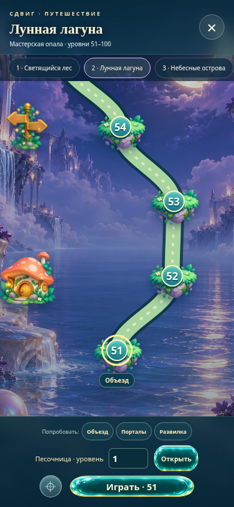

# Сдвиг 0.14 — Желейные тропы

Тестовая версия с новыми механиками, мультяшной спрайтовой картой и живыми желейками. **Все 500 уровней открыты.** Версия 0.13 сохранена рядом.

## Скачать и запустить

- **[Скачать тестовую игру ZIP](https://github.com/Pash1n/gptgame/raw/refs/heads/main/Sdvig_0.14_TEST_ALL_500.zip)** — распакуйте и откройте `Sdvig_TEST_ALL_500.html` в браузере. Всё встроено в один файл.
- [Скачать HTML отдельно](https://github.com/Pash1n/gptgame/raw/refs/heads/main/Sdvig_0.14_TEST_ALL_500.html). Если браузер показывает код, используйте ZIP выше.
- [Обычная статическая сборка](https://github.com/Pash1n/gptgame/raw/refs/heads/main/Sdvig_0.14_build.zip).
- [Исходники, тесты, отчёты, исходный атлас](https://github.com/Pash1n/gptgame/raw/refs/heads/main/Sdvig_0.14_sources.zip).

Первый запуск автономного теста открывает уровень **51**. Через **Карта → Объезд / Порталы / Развилка** доступны новые уроки **51, 131, 151**. Есть переход к любому номеру 1–500. Сохранение песочницы отдельное.

## Что нового

- Объезд штифта действительно захватывает три клетки соседнего ряда или столбца. Путь подсвечивается при перетаскивании.
- Порталы обменивают желейки, если сдвиг задевает ровно один вход.
- Сборка на указателе переключает сторону объезда.
- Новые правила встроены в 113 уровней, для каждого сохранено проверенное решение.
- Новая рисованная карта: островки, кристаллы, грибные домики, сундуки, порталы, указатели и светлячки.
- Желейки дышат, покачиваются, растягиваются при движении и пружинят при остановке.

## Проверки и ограничения

500/500 уровней автоматически пройдены игровым движком и в автономной HTML-сборке Chromium. Состояния после каждого современного хода сравнены с общим расчётным движком, включая новые правила. Прошли 19 тестов правил, 18 проверок новых функций и 18 проверок управления/сохранений.

Подробности: [отчёт](Sdvig_0.14_REPORT_RU.md), [контрольные суммы](Sdvig_0.14_SHA256SUMS.txt).

Это автоматические проверки и эмуляция мобильных устройств, а не полный человеческий плейтест. Физические смартфоны, Safari, Firefox и реальный FPS на телефонах не проверены. В облачной тестовой среде file:// запрещён политикой Chromium, поэтому проверки выполнены через HTTP. На устройстве, не позволяющем открывать HTML из файлов, используйте статический HTTP-сервер. Прогресс зависит от localStorage и origin браузера.

## Предыдущая версия

[Сдвиг 0.13 — тест всех 500 уровней](https://github.com/Pash1n/gptgame/raw/refs/heads/main/Sdvig_0.13_TEST_ALL_500.zip).
