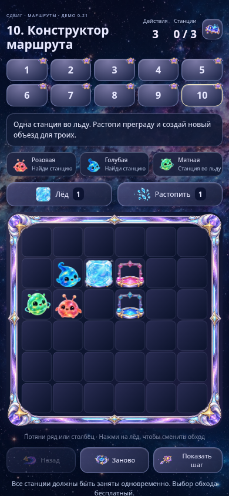
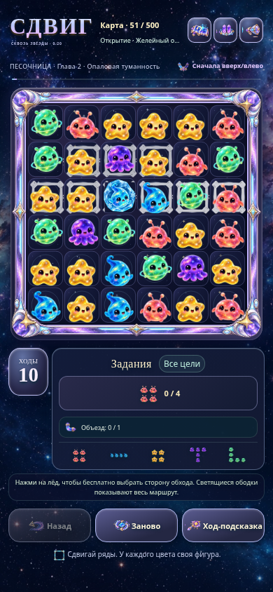
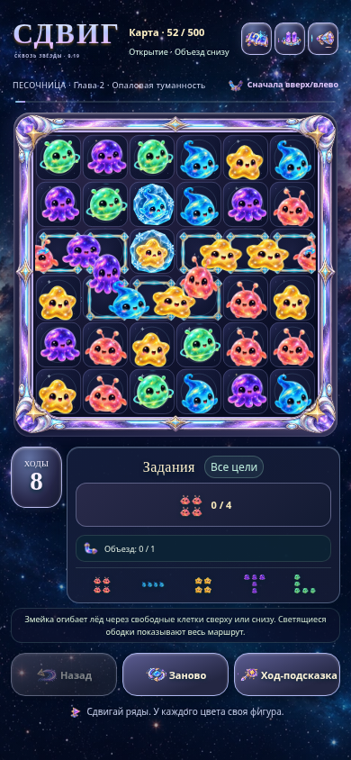
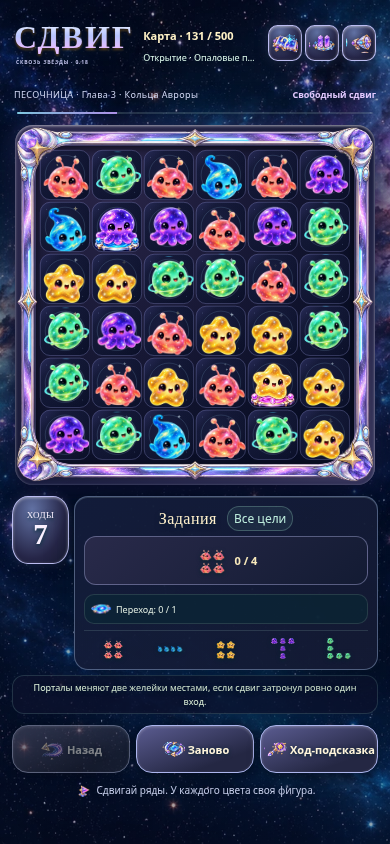
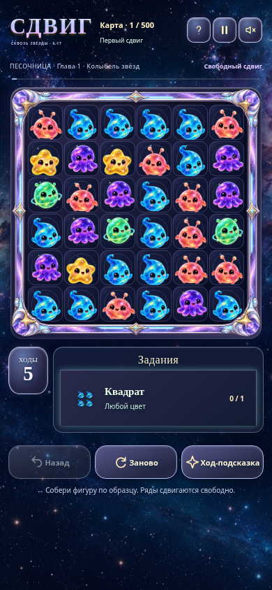
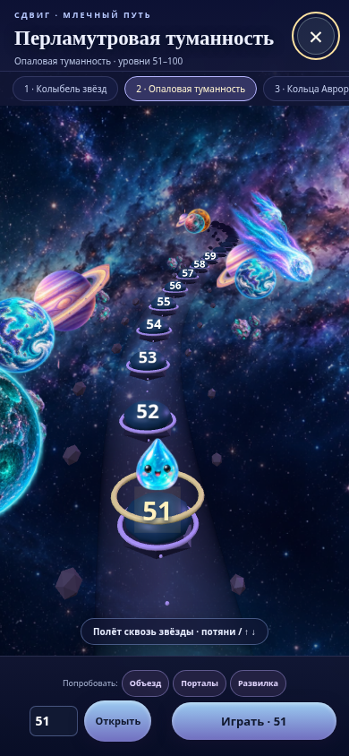

# Сдвиг · Магнитная мастерская 0.37 — первая глава: электростанция

Пять уровней добычи и пять сборок: редуктор, двигатель, генератор, охлаждение и пульт. Затем устанавливаем агрегаты на общую раму, соединяем привод, шланги и питание, запускаем станцию. В уровнях 24 → 27 → 29 → 33 → 37 физических предметов, перегородка с проходом, препятствия и хрупкий груз.

- **[Скачать игру — ZIP, 7 МБ](https://github.com/Pash1n/gptgame/raw/refs/heads/main/Sdvig_CRANE_0.37.zip?v=037)**. Распакуйте и откройте `Sdvig_MAGNETIC_CRANE.html` браузером.
- **Сразу посмотреть сборки:** меню → «Тест верстака · детали выданы», затем выберите любой узел или всю станцию. Тест не меняет основной прогресс.
- [Механизмы в движении — GIF](https://github.com/Pash1n/gptgame/raw/refs/heads/main/Sdvig_CRANE_0.37_chapter.gif?v=037) · [Готовая станция](https://github.com/Pash1n/gptgame/raw/refs/heads/main/Sdvig_CRANE_0.37_station.png?v=037) · [Телефон](https://github.com/Pash1n/gptgame/raw/refs/heads/main/Sdvig_CRANE_0.37_phone.png?v=037).
- [Исходники — ZIP](https://github.com/Pash1n/gptgame/raw/refs/heads/main/Sdvig_CRANE_0.37_sources.zip?v=037) · [Код](sdvig-crane-0.37/) · [Проверки и ограничения](Sdvig_CRANE_0.37_REPORT_RU.md).

**Справа — детали текущего узла, слева — лишний металл.** Смешанная партия остаётся в приёмнике до извлечения лишней детали; подпись и красная подсветка показывают причину. Добыча, сборки и запуск станции сохраняются; данные редуктора 0.36 мигрируют. Прежние режимы сохранены.

Все пять новых уровней пройдены физическим оператором в Node и Chromium. Все шесть сборок проверены мышью, пульт — мобильными касаниями; проверены сохранения, 24 сочетания сборки/экрана и автономный HTML без сети. Это первая глава, остальные объекты города пока не готовы. Реальные слабые телефоны и Safari не проверены. Предыдущие версии сохранены ниже.

---

# Сдвиг · Магнитная мастерская 0.36 — свалка и сборочный верстак

Первый полный цикл новой идеи: добыть шесть деталей среди 30 физических предметов, собрать редуктор на отдельном 3D-верстаке, затянуть четыре болта и запустить шестерни. Свет, материалы и объёмная мастерская приближены к концепту; это один узел будущей станции, не готовый город.

- **[Скачать игру — ZIP, 7 МБ](https://github.com/Pash1n/gptgame/raw/refs/heads/main/Sdvig_CRANE_0.36.zip?v=036)**. Распакуйте и откройте `Sdvig_MAGNETIC_CRANE.html`.
- **Сразу попробовать сборку:** меню → «Тест верстака · детали выданы». Тест не меняет основное сохранение.
- [Сборка в движении — GIF](https://github.com/Pash1n/gptgame/raw/refs/heads/main/Sdvig_CRANE_0.36_assembly.gif?v=036) · [Настоящий скриншот верстака](https://github.com/Pash1n/gptgame/raw/refs/heads/main/Sdvig_CRANE_0.36_gears.png?v=036) · [Телефон](https://github.com/Pash1n/gptgame/raw/refs/heads/main/Sdvig_CRANE_0.36_phone.png?v=036).
- [Исходники — ZIP](https://github.com/Pash1n/gptgame/raw/refs/heads/main/Sdvig_CRANE_0.36_sources.zip?v=036) · [Код](sdvig-crane-0.36/) · [Проверки и ограничения](Sdvig_CRANE_0.36_REPORT_RU.md).

Новый уровень пройден в Node и Chromium обычными командами крана. Сборка проверена реальными мышиными и мобильными CDP-жестами, сохранения и офлайн-HTML проверены отдельно. Старый прогресс и все прежние режимы сохранены; десять старых глав заново целиком в 0.36 не проходились. Реальные слабые телефоны и Safari здесь не проверены. Все предыдущие версии сохранены ниже.

---

# Сдвиг · Магнитная мастерская 0.35 — история о перевозчике

Спаси четверых маленьких роботов и восстанови большого перевозчика. Десять связанных глав меняют мастерскую: генератор, привод, опоры, энергоячейки, палуба и кабина. В финале команда размещается на машине, она делает первые шаги. Стол теперь стоит на шести опорах над настоящим полом цеха, колонны крана доходят до пола.

- **[Скачать игру — ZIP, 7 МБ](https://github.com/Pash1n/gptgame/raw/refs/heads/main/Sdvig_CRANE_0.35.zip?v=035)**. Распакуйте и откройте `Sdvig_MAGNETIC_CRANE.html` браузером.
- [Первый запуск перевозчика — GIF](https://github.com/Pash1n/gptgame/raw/refs/heads/main/Sdvig_CRANE_0.35_story.gif?v=035) · [Команда на борту](https://github.com/Pash1n/gptgame/raw/refs/heads/main/Sdvig_CRANE_0.35_hero.png?v=035).
- [Рабочая площадка на ПК](https://github.com/Pash1n/gptgame/raw/refs/heads/main/Sdvig_CRANE_0.35_desktop.png?v=035) · [Телефон](https://github.com/Pash1n/gptgame/raw/refs/heads/main/Sdvig_CRANE_0.35_phone.png?v=035).
- [Исходники — 12,3 МБ](https://github.com/Pash1n/gptgame/raw/refs/heads/main/Sdvig_CRANE_0.35_sources.zip?v=035) · [Код](sdvig-crane-0.35/) · [Проверки и ограничения](Sdvig_CRANE_0.35_REPORT_RU.md).

Кнопка «Перевозчик» показывает ремонт и спасённых роботов. Главы открываются по порядку; в меню есть тестовый доступ ко всем, прежние три заказа и свободная игра. Добавлены хрупкие энергоячейки, настоящий проход в перегородке и физический пол под столом. Прогресс истории сохраняется отдельно от старых отметок заказов.

Проверены все 10 глав в Node и Chromium без телепортации груза, старые три заказа, разрушение/повтор ячейки, сохранения, финальный запуск, управление, пауза/WebGL restore и автономный HTML без сети. Это короткая кампания, не 500 уровней; перевозчик сюжетно анимирован, реальный аппаратный FPS и телефоны не проверены. Предыдущие версии сохранены ниже.

---

# Сдвиг · Магнитная мастерская 0.34 — кран-балка и срыв связок

Настоящая 3D-кран-балка с направляющими, тележкой, роликами и вращающимся барабаном. Кружок заменён тенью по геометрии и реальному качанию магнита. Межпредметные соединения могут рваться от перегрузки; нижняя ветка падает с сохранением скоростей. Обычная плавная перевозка надёжна, резкие развороты рискованны.

- **[Скачать игру — ZIP, 6,6 МБ](https://github.com/Pash1n/gptgame/raw/refs/heads/main/Sdvig_CRANE_0.34.zip?v=034)**. Распакуйте и откройте `Sdvig_MAGNETIC_CRANE.html` браузером.
- [Запись захвата и перевозки — GIF](https://github.com/Pash1n/gptgame/raw/refs/heads/main/Sdvig_CRANE_0.34_gameplay.gif?v=034) · [Кран с грузом](https://github.com/Pash1n/gptgame/raw/refs/heads/main/Sdvig_CRANE_0.34_hero.png?v=034) · [Телефон](https://github.com/Pash1n/gptgame/raw/refs/heads/main/Sdvig_CRANE_0.34_phone.png?v=034) · [ПК](https://github.com/Pash1n/gptgame/raw/refs/heads/main/Sdvig_CRANE_0.34_desktop.png?v=034).
- [Исходники — 12,3 МБ](https://github.com/Pash1n/gptgame/raw/refs/heads/main/Sdvig_CRANE_0.34_sources.zip?v=034) · [Код](sdvig-crane-0.34/) · [Проверки и ограничения](Sdvig_CRANE_0.34_REPORT_RU.md).

Перед срывом — искры и предупреждение. Прямой захват магнитом намного прочнее вторичных соединений. ПК: WASD, Q вверх, E вниз, пробел — магнит. Телефон: первый палец ведёт, второй меняет высоту; кнопка работает при удержании поля. На паузе есть «Продолжить».

Проверены покой и плавное движение без срыва, физический разрыв от разворотов, сохранение скорости нижней ветки, движение конструкции и тени, все три заказа в Node/Chromium, ввод, возврат/WebGL restore и автономный HTML без сети. Прочность игровая, баланс требует испытаний; мягкая тень магнита ограничена основной площадкой, кран не имеет коллизий с грузом. Реальные телефоны и аппаратный FPS не проверены. Предыдущие версии сохранены ниже.

---

# Сдвиг · Магнитная мастерская 0.33 — управление и возврат

Исправлен отсчёт кадров при неровных интервалах и работа после паузы/ухода. Один RAF-цикл, сброс таймеров, сохранение облегчённого разрешения, восстановление WebGL. На экране паузы — большая кнопка «Продолжить». Убраны совпадающие поверхности бортов приёмников.

- **[Скачать игру — ZIP, 6,6 МБ](https://github.com/Pash1n/gptgame/raw/refs/heads/main/Sdvig_CRANE_0.33.zip?v=033)**. Распакуйте и откройте `Sdvig_MAGNETIC_CRANE.html` браузером.
- [Исходники — 12,3 МБ](https://github.com/Pash1n/gptgame/raw/refs/heads/main/Sdvig_CRANE_0.33_sources.zip?v=033) · [Код](sdvig-crane-0.33/) · [Замечания и исправления](sdvig-crane-0.33/CHANGELOG_RU.md) · [Проверки и ограничения](Sdvig_CRANE_0.33_REPORT_RU.md).
- [Телефон](https://github.com/Pash1n/gptgame/raw/refs/heads/main/Sdvig_CRANE_0.33_phone.png?v=033) · [ПК](https://github.com/Pash1n/gptgame/raw/refs/heads/main/Sdvig_CRANE_0.33_desktop.png?v=033).

**ПК: WASD — движение, Q — вверх, E — вниз, пробел — магнит.** Мышь больше не двигает кран. На телефоне кнопка магнита работает вторым пальцем при удержании поля. Пробел после меню не нажимает меню повторно; браузерное выделение отключено.

Проверены три заказа, жесты, физика, регрессии ввода, повторные обработчики ухода/возврата, отсутствие роста GPU-ресурсов, восстановление контекста и автономный HTML без сети. Headless Chromium не воспроизводит настоящую смену видимости вкладок: события скрытия/потери фокуса проверены явно. Поведение на ПК игрока и аппаратный FPS ещё предстоит подтвердить. Подробности в отчёте. Предыдущие версии сохранены ниже.

---

# Сдвиг · Магнитная мастерская 0.32 — оптимизация

Облегчён рендер версии 0.31: один проход сцены, объединённые тени вместо VSM с размытием, меньше лишних граней и источников света. На паузе и в скрытой вкладке отрисовка останавливается. Включены ограничение пикселей и автоматическое снижение разрешения при тормозах. Физика, предметы, управление и прогресс сохранены.

- **[Скачать оптимизированную игру — 6,1 МБ](https://github.com/Pash1n/gptgame/raw/refs/heads/main/Sdvig_CRANE_0.32.zip?v=032)**. Распакуйте и откройте `Sdvig_MAGNETIC_CRANE.html` браузером.
- [Скриншот телефона](https://github.com/Pash1n/gptgame/raw/refs/heads/main/Sdvig_CRANE_0.32_phone.png?v=032) · [Скриншот ПК](https://github.com/Pash1n/gptgame/raw/refs/heads/main/Sdvig_CRANE_0.32_desktop.png?v=032).
- [Исходники — 12,3 МБ](https://github.com/Pash1n/gptgame/raw/refs/heads/main/Sdvig_CRANE_0.32_sources.zip?v=032) · [Код](sdvig-crane-0.32/) · [Измерения, проверки и ограничения](Sdvig_CRANE_0.32_REPORT_RU.md).

Графика в меню: **авто → чётче → быстрее**. Начните с авто; если медленно — выберите быстрее. В контрольной сцене число команд сокращено с 345 до 113–126 на кадр, число треугольников всех проходов — с 520 тыс. до 90–176 тыс. Это не обещание пропорционального роста FPS. На физических устройствах аппаратный FPS пока не измерен.

Прошли проверки физики, жестов, всех трёх заказов в Node и Chromium, пяти размеров экрана, автоматического разрешения, остановки на паузе, переноса сохранений и автономного HTML без сети. Предыдущая версия ниже сохранена.

---

# Сдвиг · Магнитная мастерская 0.31 — ближе к концепту

Новые округлые 3D-роботы с оптикой и подвижным взглядом, антенны, медные обмотки магнита, износ краски на кромках, мягкие тени и контактное затенение. Тёплый нарисованный фон мастерской окружает настоящую физическую 3D-площадку. Камера крупнее и следит за грузом, приёмники получили пиктограммы и подсветку. Реальные скриншоты и GIF записаны из игры, это не изображения концепта.

- **[Скачать игру ZIP — 6,2 МБ](https://github.com/Pash1n/gptgame/raw/refs/heads/main/Sdvig_CRANE_0.31.zip?v=031)**. Распакуйте и откройте `Sdvig_MAGNETIC_CRANE.html` браузером. Ресурсы встроены, интернет для игры не нужен. Требуется WebGL.
- [Настоящий экран телефона](https://github.com/Pash1n/gptgame/raw/refs/heads/main/Sdvig_CRANE_0.31_phone.png?v=031) · [Подъём груза](https://github.com/Pash1n/gptgame/raw/refs/heads/main/Sdvig_CRANE_0.31_hero.png?v=031) · [Экран ПК](https://github.com/Pash1n/gptgame/raw/refs/heads/main/Sdvig_CRANE_0.31_desktop.png?v=031).
- [Захват, раскачивание и перенос — GIF](https://github.com/Pash1n/gptgame/raw/refs/heads/main/Sdvig_CRANE_0.31_gameplay.gif?v=031) · [Исходный художественный концепт](https://github.com/Pash1n/gptgame/raw/refs/heads/main/Sdvig_CRANE_mobile_concept_01.png?v=concept01).
- [Исходники — 12,3 МБ](https://github.com/Pash1n/gptgame/raw/refs/heads/main/Sdvig_CRANE_0.31_sources.zip?v=031) · [Код](sdvig-crane-0.31/) · [Проверки и ограничения](Sdvig_CRANE_0.31_REPORT_RU.md).

**На телефоне:** первым пальцем ведите магнит. Поставьте второй и двигайте его вверх-вниз для высоты. Если убрать первый, оставшийся продолжит перемещение без скачка. Убирая пальцы, груз не отпускаете: для этого есть большая кнопка. Мелкие настройки и общий вид находятся в меню, ползунок на телефоне скрыт. На ПК доступны мышь, колесо, Q/E и пробел.

Проверены пять сценариев сенсорного контроллера, семь физических проверок, реальные эмулированные двухпальцевые события CDP, пять размеров экрана и все три заказа в Chromium. Автономный HTML без сети открывает все режимы и позволяет выполнить первый заказ. Отметки старых заказов совместимы, сохранения поезда не меняются.

Это работающий прототип и приближение к концепту, не попиксельная копия. Дальний фон нарисован; подвижные объекты объёмные. Физические телефоны и Safari не проверены. Для слабого устройства есть сохраняемый экономный режим эффектов. Большой кампании и звука пока нет.

---

# Сдвиг · Магнитная свалка 0.30 — настоящий 3D-кран

Отдельный прототип: управляй магнитом над свалкой, собирай физические связки, поднимай и сбрасывай груз в нужный приёмник. Шесть видов находок, 18 предметов, восемь физических звеньев подвеса, предел 12 кг. Три коротких заказа и свободная свалка. Модели объёмные, столкновения, вращение, инерция, вес и падение рассчитывает Cannon-es. Материалы, освещение и динамические тени — Three.js.

- **[Скачать игру ZIP — 3,4 МБ](https://github.com/Pash1n/gptgame/raw/refs/heads/main/Sdvig_CRANE_0.30.zip?v=030)**. Распакуйте и откройте `Sdvig_MAGNETIC_CRANE.html` браузером. Все ресурсы встроены, установка и интернет для игры не нужны. Требуется WebGL.
- [Скриншот с захватом](https://github.com/Pash1n/gptgame/raw/refs/heads/main/Sdvig_CRANE_0.30_carry.png?v=030) · [Общий экран](https://github.com/Pash1n/gptgame/raw/refs/heads/main/Sdvig_CRANE_0.30_desktop.png?v=030) · [Телефон](https://github.com/Pash1n/gptgame/raw/refs/heads/main/Sdvig_CRANE_0.30_phone.png?v=030).
- [Реальный захват, перенос и сброс — GIF](https://github.com/Pash1n/gptgame/raw/refs/heads/main/Sdvig_CRANE_0.30_gameplay.gif?v=030).
- [Исходники — 6 МБ](https://github.com/Pash1n/gptgame/raw/refs/heads/main/Sdvig_CRANE_0.30_sources.zip?v=030) · [Код](sdvig-crane-0.30/) · [Проверки и ограничения](Sdvig_CRANE_0.30_REPORT_RU.md).

Перетаскивайте мышь или палец по площадке. Опустите магнит кнопкой/ползунком, включите притяжение, поднимите груз, перенесите и отключите над приёмником. Ремонт принимает роботов и шестерни, переработка — болты, трубы и мотор. Шины не магнитятся. Колесо мыши меняет высоту, пробел включает магнит. Кнопка «Ближе» увеличивает площадку.

Три заказа пройдены оператором, который меняет только положение крана, высоту и магнит, не телепортируя предметы и не форсируя захват. Первый заказ дополнительно пройден в браузере и в автономном HTML после отключения сети. Семь проверок физики, реальные мышиные и эмулированные touch-события, четыре размера экрана. Сохранения предыдущей игры не изменены.

Это игровой прототип, не большая кампания. Коллайдеры приближённые, роботы целиком твёрдые, столкновения звеньев цепи отключены. Реальные телефоны, Safari и стабильные 60 FPS не проверены. Музыки и звука пока нет.

---

# Сдвиг · Магнитный диспетчер 0.27 — 25 участков

Добавлены двадцать новых уровней 6–25 с обучением по главам: две развилки, несколько складов, сборка состава, два держателя ворот, две стоянки и повторное использование помощника. С 9-го участка виден запас хода; с 22-го станции принимают груз по номерам заказа. Станция вне очереди объясняет причину и пропускает вагон дальше. Новые индикаторы нарисованы отдельными спрайтами в стиле мастерской.

- **[Скачать игру ZIP — 37 МБ](https://github.com/Pash1n/gptgame/raw/refs/heads/main/Sdvig_DISPATCH_0.27_LEVELS_1-25.zip?v=027)**. Распакуйте и откройте `Sdvig_DISPATCH.html` браузером. Все 25 участков открыты.
- [25-й участок](https://github.com/Pash1n/gptgame/raw/refs/heads/main/Sdvig_DISPATCH_0.27_desktop.png?v=027) · [Телефон](https://github.com/Pash1n/gptgame/raw/refs/heads/main/Sdvig_DISPATCH_0.27_phone.png?v=027) · [Ускоренная запись реального заезда — GIF](https://github.com/Pash1n/gptgame/raw/refs/heads/main/Sdvig_DISPATCH_0.27_train.gif?v=027).
- [Исходники — 41 МБ](https://github.com/Pash1n/gptgame/raw/refs/heads/main/Sdvig_DISPATCH_0.27_sources.zip?v=027) · [Код](sdvig-dispatch-0.27/) · [Таблица уровней, проверки и ограничения](Sdvig_DISPATCH_0.27_REPORT_RU.md).

Первые пять уровней не изменены, сохранения 0.25/0.26 совместимы. Полностью перебраны 5 939 допустимых программ этих фиксированных схем; каждый уровень разрешим. Все 25 решений пройдены через интерфейс Chromium и в автономном HTML с отключённой сетью. Проверены 880 стыков, 27 720 точек геометрии, расход заряда, очередность, обе карточки ворот, старые сохранения и четыре размера экрана.

Это 25 подготовленных участков, не 500 уровней и не свободный редактор железных дорог. Физические телефоны и другие браузеры не проверены. Инженерная оценка сложности не заменяет пользовательский плейтест.

---

# Сдвиг · Магнитный диспетчер 0.26 — поле и понятные действия

Рельсы и движение поезда используют общую геометрию: стыки совпадают, фигуры и платформы стоят по центрам. Новая пустая рамка устраняет обрезки плиток, у стола появились более толстые затенённые боковины и передняя стенка. Спрайты локомотива и шлагбаума перенарезаны без обрезанных частей.

- **[Скачать игру ZIP — 35 МБ](https://github.com/Pash1n/gptgame/raw/refs/heads/main/Sdvig_DISPATCH_0.26_DEMO_1-5.zip?v=026)**. Распакуйте и откройте `Sdvig_DISPATCH.html` браузером. Все пять уровней открыты.
- [Исправленное поле](https://github.com/Pash1n/gptgame/raw/refs/heads/main/Sdvig_DISPATCH_0.26_field.png?v=026) · [Анимация настоящего заезда — GIF](https://github.com/Pash1n/gptgame/raw/refs/heads/main/Sdvig_DISPATCH_0.26_train.gif?v=026) · [На телефоне](https://github.com/Pash1n/gptgame/raw/refs/heads/main/Sdvig_DISPATCH_0.26_phone.png?v=026).
- [Исходники — 38 МБ](https://github.com/Pash1n/gptgame/raw/refs/heads/main/Sdvig_DISPATCH_0.26_sources.zip?v=026) · [Код](sdvig-dispatch-0.26/) · [Проверки и ограничения](Sdvig_DISPATCH_0.26_REPORT_RU.md).

Сцепка, отцепление, парковка и доставка показаны отдельными анимациями, рисованными значками и пояснениями. Любой вагон на B открывает шлагбаум: платформа соединена с ним видимым кабелем. После подбора вагона ворота закрываются, причина объясняется прямо под полем. Сохранения 0.25 совместимы.

Проверены все пять решений через интерфейс и в автономном HTML после отключения сети. Результаты всех 111 допустимых программ и 2 332 состояния поездов совпали с 0.25. Проверены 112 стыков путей и 3 696 точек геометрии. Физические телефоны и другие браузеры не проверены; это пять демонстрационных уровней, не кампания на 500 уровней.

---

# Сдвиг · Магнитный диспетчер — прототип 0.25

Новая основа: поезд едет самостоятельно, игрок заранее настраивает развилки, магниты и сцепки. Важны хвост состава, порядок доставки и возвращение за оставленным помощником. Отдельная игра с пятью открытыми уровнями; предыдущие версии и их сохранения сохранены.

- **[Скачать игру ZIP — 27 МБ](https://github.com/Pash1n/gptgame/raw/refs/heads/main/Sdvig_DISPATCH_0.25_DEMO_1-5.zip?v=025)**. Распакуйте и откройте `Sdvig_DISPATCH.html` браузером.
- [Скриншот](https://github.com/Pash1n/gptgame/raw/refs/heads/main/Sdvig_DISPATCH_0.25_phone.png?v=025) · [Реальный заезд поезда — GIF](https://github.com/Pash1n/gptgame/raw/refs/heads/main/Sdvig_DISPATCH_0.25_train.gif?v=025).
- [Исходники — 28 МБ](https://github.com/Pash1n/gptgame/raw/refs/heads/main/Sdvig_DISPATCH_0.25_sources.zip?v=025) · [Код](sdvig-dispatch-0.25/).
- [Механики, проверки и ограничения](Sdvig_DISPATCH_0.25_REPORT_RU.md).

1–2 — запуск и выбор ветки, 3 — порядок вагонов и программа двух кругов, 4 — помощник удерживает ворота, 5 — подбор нового вагона. «План-пример» выставляет проверенную конфигурацию. Пауза, один шаг и бесплатный возврат помогают разбираться. На телефоне настройки находятся под полем. Настройки во время заезда заблокированы.

Проверены все 111 допустимых конфигураций этой небольшой модели и все пять решений в Chromium. Автономный HTML не запрашивает внешние ресурсы, все пять уровней пройдены после отключения сети. Физические смартфоны и другие браузеры не проверены. Пути и места устройств фиксированы; свободного строительства рельсов пока нет. Это прототип для оценки новой механики, не кампания на 500 уровней.

---

# Сдвиг 0.24 — исправление индикатора магнита

[Скачать исправленную игру ZIP — 33 МБ](https://github.com/Pash1n/gptgame/raw/refs/heads/main/Sdvig_ROBOTS_0.24_DEMO_1-10.zip?v=024). Распакуйте и откройте `Sdvig_ROBOTS.html`.

Свечение магнита теперь показывает фактический доступный объезд с учётом препятствий. До определения направления жеста подсвечивается только захваченная клетка. Предпросмотр, анимация и перестановка используют один маршрут. Проверены 1 290 перестановок, 20 реальных жестов, оба направления движения и все 10 уровней в автономной сборке. Сохранения совместимы с 0.22/0.23.

[Код и отчёт исправления](sdvig-robots-0.24/).

---

# Сдвиг · Магнитная мастерская 2.5D · 0.23

Перспективный стол с объёмной текстурной боковиной, стоящие вертикально роботы, масштаб по удалению, порядок перекрытий и тени на наклонной поверхности. Световой маршрут и станции лежат на столе. Управление использует обратную проекцию и выбор по непрозрачным частям роботов. Все 10 уровней открыты; правила и сохранения 0.22 совместимы.

- **[Скачать игру ZIP — 33 МБ](https://github.com/Pash1n/gptgame/raw/refs/heads/main/Sdvig_ROBOTS_0.23_DEMO_1-10.zip?v=023)**. Распакуйте и откройте `Sdvig_ROBOTS.html` браузером.
- [Скриншот 2.5D](https://github.com/Pash1n/gptgame/raw/refs/heads/main/Sdvig_ROBOTS_0.23_phone.png?v=023) · [GIF из игры](https://github.com/Pash1n/gptgame/raw/refs/heads/main/Sdvig_ROBOTS_0.23_gameplay.gif?v=023).
- [Исходники с оригинальными PNG — 47 МБ](https://github.com/Pash1n/gptgame/raw/refs/heads/main/Sdvig_ROBOTS_0.23_sources.zip?v=023) · [Код](sdvig-robots-0.23/).
- [Отдельный HTML](https://github.com/Pash1n/gptgame/raw/refs/heads/main/Sdvig_ROBOTS_0.23_DEMO_1-10.html?v=023) · [Сборка с отдельными спрайтами](https://github.com/Pash1n/gptgame/raw/refs/heads/main/Sdvig_ROBOTS_0.23_build.zip?v=023).
- [Проверки и ограничения](Sdvig_ROBOTS_0.23_REPORT_RU.md).

Все 10 решений пройдены в исходной и автономной сборках Chromium. Дополнительно проверены 7 203 прямых/обратных преобразования, реальные вертикальные и отрицательные жесты, touch, выбор корпуса робота, отмена, сохранения, уменьшение движения и отсутствие внешних ресурсов. Камера фиксирована, персонажи — рисованные спрайты. Физические телефоны и другие браузеры не проверялись; автоматический запуск file:// блокируется политикой управляемого Chromium. Предыдущие версии сохранены.

---

# Сдвиг · Магнитная мастерская 0.22

Рабочая версия по концепту с ржавыми роботами: 76 нарисованных спрайтов, металлическое поле и интерфейс, тени, взгляды и моргание, магнитные захваты с раскрытием, светящийся объезд и предпросмотр позиций. Все 10 участков доступны сразу.

- **[Скачать игру ZIP — 32 МБ](https://github.com/Pash1n/gptgame/raw/refs/heads/main/Sdvig_ROBOTS_0.22_DEMO_1-10.zip?v=022)**. Распакуйте и откройте `Sdvig_ROBOTS.html` браузером.
- [Отдельный автономный HTML](https://github.com/Pash1n/gptgame/raw/refs/heads/main/Sdvig_ROBOTS_0.22_DEMO_1-10.html?v=022).
- [Исходники и оригинальные PNG — 45 МБ](https://github.com/Pash1n/gptgame/raw/refs/heads/main/Sdvig_ROBOTS_0.22_sources.zip?v=022).
- [Обычная сборка с отдельными спрайтами — 22 МБ](https://github.com/Pash1n/gptgame/raw/refs/heads/main/Sdvig_ROBOTS_0.22_build.zip?v=022).
- [GIF из игры](https://github.com/Pash1n/gptgame/raw/refs/heads/main/Sdvig_ROBOTS_0.22_gameplay.gif?v=022) · [Скриншот телефона](https://github.com/Pash1n/gptgame/raw/refs/heads/main/Sdvig_ROBOTS_0.22_phone.png?v=022) · [Путь при перетаскивании](https://github.com/Pash1n/gptgame/raw/refs/heads/main/Sdvig_ROBOTS_0.22_route.png?v=022).
- [Проверки и ограничения](Sdvig_ROBOTS_0.22_REPORT_RU.md) · [Код версии](sdvig-robots-0.22/).

Все 10 уровней пройдены в Chromium в исходной и автономной сборках с полным сравнением состояния после каждого действия. Проверены touch, клавиатура, инструменты, отмена, сохранения, импорт 0.21, предпросмотр и уменьшение движения. Единый HTML не запрашивает внешние ресурсы; после загрузки проверена игра с отключённой сетью. Автоматический запуск file:// блокируется политикой управляемого Chromium и не подтверждён. Физические телефоны и другие браузеры не проверялись. Новая графика пока применена к отдельной главе из 10 уровней; кампания на 500 уровней остаётся в предыдущих версиях.

Предыдущие версии и исходные файлы сохранены. Сохранения 0.21 импортируются при доступности прежнего localStorage на том же origin; старый ключ не изменяется.

---

# Сдвиг · Маршруты — демо 0.21, уровни 1–10

Отдельная рабочая глава нового режима: одновременно поставить желеек на станции своего цвета. Совпадения не уничтожают фигуры. Выбирайте обход, создавайте лёд и растапливайте преграды. Все 10 уровней открыты.

- **[Скачать игру ZIP — 4 МБ](https://github.com/Pash1n/gptgame/raw/refs/heads/main/Sdvig_ROUTES_0.21_DEMO_1-10.zip)**. Распакуйте и откройте Sdvig_ROUTES_DEMO.html.
- [Отдельный HTML](https://github.com/Pash1n/gptgame/raw/refs/heads/main/Sdvig_ROUTES_0.21_DEMO_1-10.html).
- [Исходники](https://github.com/Pash1n/gptgame/raw/refs/heads/main/Sdvig_ROUTES_0.21_sources.zip).
- [Обычная сборка](https://github.com/Pash1n/gptgame/raw/refs/heads/main/Sdvig_ROUTES_0.21_build.zip).
- [Посмотреть решение уровня 10 — GIF](https://raw.githubusercontent.com/Pash1n/gptgame/main/Sdvig_ROUTES_0.21_level10.gif).
- [Проверки и ограничения](Sdvig_ROUTES_0.21_REPORT_RU.md).

1–5 знакомят с доставкой и обходами, 6 требует двух станций, 7 — создать лёд, 8 — растопить, 9 — сочетать обходы, 10 — применить оба инструмента для трёх целей. «Показать шаг» выполняет один шаг примера; ошибку можно отменить даже после проигрыша. Нажатие на лёд меняет сторону бесплатно. Сдвиги и инструменты расходуют действия.

Все 10 уровней проверены в Chromium в исходной и автономной сборках, с полным сравнением состояния после каждого действия. Дополнительно проверены настоящие touch-жесты, кнопки, клавиатура, undo/reload, отсутствие внешних ресурсов и необходимость инструментов в заданных бюджетах. Реальные устройства и другие браузеры не проверены. Это короткая демонстрационная глава, не новая кампания из 500 уровней. Старые версии и их прогресс сохранены отдельно.

---

# Сдвиг 0.20 — подсветка и выбираемые обходы

Стрелка удерживаемого сдвига убрана. При захвате и частичном движении ободки белые, при смещении на одну клетку и больше — цветные, при возврате снова белые. Нажатие на лёд бесплатно меняет сторону обхода; соседняя ледяная группа переключается вместе. Выбор отменяется и сохраняется с полем.

- **[Скачать игру ZIP](https://github.com/Pash1n/gptgame/raw/refs/heads/main/Sdvig_0.20_TEST_ALL_500.zip)** — распакуйте и откройте Sdvig_TEST_ALL_500.html.
- [Отдельный HTML](https://github.com/Pash1n/gptgame/raw/refs/heads/main/Sdvig_0.20_TEST_ALL_500.html).
- [Исходники](https://github.com/Pash1n/gptgame/raw/refs/heads/main/Sdvig_0.20_sources.zip).
- [Обычная сборка](https://github.com/Pash1n/gptgame/raw/refs/heads/main/Sdvig_0.20_build.zip).
- [Проект нового основного режима](SNAKE_GAME_DESIGN_RU.md).
- [Проверки и ограничения](Sdvig_0.20_REPORT_RU.md).

На карте открыты все 500 уровней. Попробуйте **51**: нажмите на лёд и потяните ряд. **52** показывает безопасный обход при занятом верхнем пути, **53** — совместное переключение соседних льдинок. Выбор задаёт предпочтение; если сторона занята, используется свободная противоположная.

В 0.20 проверены 28 тестов ядра, все 500 уровней в исходной и автономной сборках Chromium (по 7750 ходов), реальные touch-жесты и пиксели подсветки, бесплатный выбор, undo и reload. Данные уровней совпадают с 0.19. Физические смартфоны и другие браузеры не проверены.

В проекте нового режима предлагаются станции доставки, инструменты заморозки/разморозки и глава из 12 заданий. Эти цели и инструменты ещё не реализованы в 0.20. Предыдущие версии сохранены ниже.

---

# Сдвиг 0.19 — ледяная змейка

Замороженные персонажи вместо закреплений. Все клетки выбранной змейки подсвечиваются рисованными ободками, кометный указатель показывает удерживаемое направление. Ряд реально огибает лёд, вытесняя только желеек на маршруте; если сверху занято, выбирается свободный нижний обход. Группы льдинок обходятся вместе, ледяные и посторонние клетки стоят. Слишком длинный жест ограничен пятью шагами.

- **[Скачать игру ZIP](https://github.com/Pash1n/gptgame/raw/refs/heads/main/Sdvig_0.19_TEST_ALL_500.zip)** — распакуйте и откройте Sdvig_TEST_ALL_500.html.
- [Отдельный HTML](https://github.com/Pash1n/gptgame/raw/refs/heads/main/Sdvig_0.19_TEST_ALL_500.html).
- [Исходники и новый атлас](https://github.com/Pash1n/gptgame/raw/refs/heads/main/Sdvig_0.19_sources.zip).
- [Обычная сборка](https://github.com/Pash1n/gptgame/raw/refs/heads/main/Sdvig_0.19_build.zip).
- [GIF из работающей игры](https://raw.githubusercontent.com/Pash1n/gptgame/main/Sdvig_0.19_snake.gif).
- [Проверки и ограничения](Sdvig_0.19_REPORT_RU.md).

Все 500 уровней доступны для теста. **51** — одиночная льдинка, **52** — обход снизу, **53** — две льдинки подряд, **54** — несколько обходов. Номер вводится на карте. Заработанные звёзды и открытые уровни сохранены; старые незавершённые поля с изменившимися правилами начинают уровень заново.

Проверены все 500 уровней в исходной и автономной сборках Chromium — по 7750 ходов, ошибок нет. 25 тестов ядра и 10 интеграционных проверок новой змейки, включая настоящие touch-жесты и миграцию сохранений. Пересчитаны решения 71 уровня, начальные поля двух пересобраны. Реальные смартфоны и другие браузеры не проверены. Обход использует непосредственно соседние линии; полностью перекрытый путь недоступен.

Предыдущие версии сохранены ниже.

---

# Сдвиг 0.18 — космические устройства

60 новых спрайтов. 20 нарисованных совместных состояний: пять желеек на двух порталах, пять закреплённых, пять с бомбой. Анимированный переход и устройства, энергетическая трасса вместо пунктира, объёмные направления, новые печати, маяки, стекло, ключи, замки и кнопки. Все 500 уровней открыты в тестовой сборке.

- **[Скачать игру ZIP](https://github.com/Pash1n/gptgame/raw/refs/heads/main/Sdvig_0.18_TEST_ALL_500.zip)** — распакуйте и откройте Sdvig_TEST_ALL_500.html.
- [Отдельный HTML](https://github.com/Pash1n/gptgame/raw/refs/heads/main/Sdvig_0.18_TEST_ALL_500.html).
- [Обычная сборка](https://github.com/Pash1n/gptgame/raw/refs/heads/main/Sdvig_0.18_build.zip).
- [Исходники и оригинальные атласы](https://github.com/Pash1n/gptgame/raw/refs/heads/main/Sdvig_0.18_sources.zip).
- [Запись анимации из игры](https://raw.githubusercontent.com/Pash1n/gptgame/main/Sdvig_0.18_portal_animation.gif).
- [Отчёт](Sdvig_0.18_REPORT_RU.md) и [утверждённое художественное направление](ART_DIRECTION_RU.md).

На карте: 131 — порталы, 51 — объезд, 151 — развилка. При отсутствии сохранения песочница начинает с 131; прежний прогресс и выбор уровня сохраняются. Уровни и формат сохранений совпадают с 0.17.

Все 500 уровней проверены в Chromium через исходную и автономную сборки, по 7679 ходов; также проверены 60 ресурсов, все 10 портальных вариантов, реальный переход, touch, отмена и reduced motion. Физические телефоны и другие браузеры не проверены. Отдельные иллюстрации сделаны для перечисленных сочетаний, не для всех возможных комбинаций механик; остальные элементы размещены по краям клетки. Предыдущие версии сохранены ниже.

---

# Сдвиг 0.17 — космические желейки

Новые инопланетяне по согласованному концепту, дыхание и покачивание, растяжение при перетаскивании, пружинящий отскок, звёзды внутри. Новая космическая рамка и панели. Все 500 уровней открыты для тестирования.

- [Скачать игру ZIP](https://github.com/Pash1n/gptgame/raw/refs/heads/main/Sdvig_0.17_TEST_ALL_500.zip) — распакуйте и откройте Sdvig_TEST_ALL_500.html.
- [Отдельный HTML](https://github.com/Pash1n/gptgame/raw/refs/heads/main/Sdvig_0.17_TEST_ALL_500.html).
- [Обычная сборка](https://github.com/Pash1n/gptgame/raw/refs/heads/main/Sdvig_0.17_build.zip).
- [Исходники и оригиналы спрайтов](https://github.com/Pash1n/gptgame/raw/refs/heads/main/Sdvig_0.17_sources.zip).
- [Отчёт о проверках](Sdvig_0.17_REPORT_RU.md).

Все 500 уровней проверены в исходной и автономной сборках Chromium, по 7679 ходов. Дополнительно проверены анимации, отмена хода, reduced motion, карта и встроенные ресурсы. Физические смартфоны и другие браузеры не проверены. Правила и формат сохранений сохранены. Предыдущие версии доступны ниже.

---

# Сдвиг 0.16 — Сквозь звёзды

Космическая версия карты: полёт через Млечный Путь, вымышленные планеты, метеориты и кометы. Все **500 уровней открыты** в тестовой сборке. Старые версии сохранены рядом.

## Скачать

- **[Игра ZIP](https://github.com/Pash1n/gptgame/raw/refs/heads/main/Sdvig_0.16_TEST_ALL_500.zip)** — распакуйте и откройте `Sdvig_TEST_ALL_500.html` в браузере. Карта открывается автоматически.
- [Отдельный HTML](https://github.com/Pash1n/gptgame/raw/refs/heads/main/Sdvig_0.16_TEST_ALL_500.html). Если виден код, используйте ZIP выше.
- [Обычная статическая сборка](https://github.com/Pash1n/gptgame/raw/refs/heads/main/Sdvig_0.16_build.zip).
- [Исходники, спрайты, исходные PNG и проверки](https://github.com/Pash1n/gptgame/raw/refs/heads/main/Sdvig_0.16_sources.zip).

## Что нового

Полностью новое космическое оформление вместо земли, деревьев и домиков: рисованный Млечный Путь, шесть детальных спрайтов планет/луны/метеоритов/кометы, орбитальные маяки и светящаяся тропа. 1260 звёзд в трёх слоях создают параллакс, при движении появляются световые шлейфы. Фон игрового поля тоже космический.

Потяните мир вниз/вверх или используйте колесо для полёта вперёд/назад. Нажмите номер маяка, затем **Играть**. Есть стрелки ↑/↓, Home/End, главы и ввод номера. Уроки механик — кнопки **Объезд / Порталы / Развилка**.

Весь движок и графика встроены, CDN не нужен. В памяти не более 22 участков. При отсутствии WebGL2 работает космическая спрайтовая карта. Правила, данные уровней и формат сохранений не менялись.

## Проверки

500/500 уровней в Chromium и автономном HTML, 7679 действий; 19 модульных тестов; 14 проверок управления картой; 6 проверок автономности и восстановления после потери WebGL-контекста. Физические телефоны, Safari, Firefox и FPS на устройствах не проверены. В облачной среде file:// запрещён политикой Chromium; проверено выполнение через HTTP. Если файловый менеджер не запускает HTML, нужен статический сервер. Сохранения зависят от origin/localStorage браузера.

[Отчёт](Sdvig_0.16_REPORT_RU.md) · [Фон игрового поля](Sdvig_0.16_board.png) · [SHA-256](Sdvig_0.16_SHA256SUMS.txt)

## Предыдущие версии

[0.15 — мир с деревьями](https://github.com/Pash1n/gptgame/raw/refs/heads/main/Sdvig_0.15_TEST_ALL_500.zip) · [0.14](https://github.com/Pash1n/gptgame/raw/refs/heads/main/Sdvig_0.14_TEST_ALL_500.zip) · [0.13](https://github.com/Pash1n/gptgame/raw/refs/heads/main/Sdvig_0.13_TEST_ALL_500.zip)

Three.js r180 включён локально, MIT-лицензия сохранена. Новая космическая графика создана специально для этой версии; исходники изображений включены в архив.
