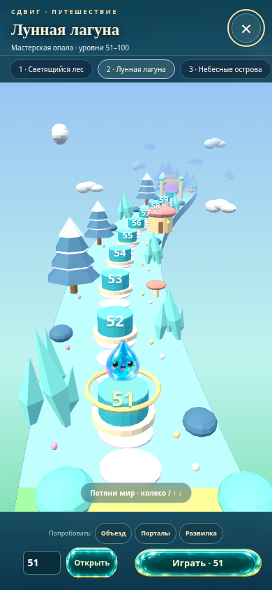

# Сдвиг 0.15 — Полёт над миром

Настоящая объёмная карта на Three.js: летите вперёд и назад над парящей дорогой, выбирайте уровни среди деревьев, кристаллов, домиков и облаков. **Все 500 уровней открыты в тестовой сборке.** Версии 0.13 и 0.14 сохранены рядом.

## Скачать

- **[Тестовая игра ZIP](https://github.com/Pash1n/gptgame/raw/refs/heads/main/Sdvig_0.15_TEST_ALL_500.zip)** — распакуйте и откройте `Sdvig_TEST_ALL_500.html` в браузере. Карта открывается автоматически.
- [Отдельный HTML](https://github.com/Pash1n/gptgame/raw/refs/heads/main/Sdvig_0.15_TEST_ALL_500.html). Если виден код, скачайте ZIP выше.
- [Обычная статическая сборка](https://github.com/Pash1n/gptgame/raw/refs/heads/main/Sdvig_0.15_build.zip).
- [Исходники и проверки](https://github.com/Pash1n/gptgame/raw/refs/heads/main/Sdvig_0.15_sources.zip).

## Как летать

Потяните мир вниз для движения вперёд, вверх — назад. Колесо мыши и стрелки ↑/↓ тоже управляют камерой. Home/End выбирают первый/последний доступный уровень. Нажмите номер площадки, затем **Играть**. Есть кнопки глав и ввод номера. Уроки новых механик доступны через **Объезд / Порталы / Развилка** (51, 131, 151).

## Что включено

Реальная 3D-геометрия, перспектива, освещение, движение камеры и инерция. 500 уровней расположены в едином мире, одновременно создаётся не более 22 ближайших участков. Three.js, графика и игра встроены в HTML, CDN не используется. При отсутствии WebGL2 или потере контекста работает прежняя спрайтовая карта. Правила головоломок, данные уровней и формат сохранений оставлены от 0.14.

## Проверено

- 500/500 уровней в Chromium и в автономном HTML, 7679 действий.
- 19 тестов правил.
- 14 проверок 3D-карты: колесо, touch, клавиатура, выбор и запуск уровня, главы, 500-й уровень, размеры экрана и остановка рендера.
- 6 отдельных проверок автономного мира, включая реальную потерю WebGL-контекста и отсутствие внешних запросов.

[Подробный отчёт](Sdvig_0.15_REPORT_RU.md) · [SHA-256](Sdvig_0.15_SHA256SUMS.txt)

Физические смартфоны и их FPS, Safari и Firefox не проверены. В облачном Chromium file:// запрещён политикой, проверки выполнены через HTTP. Если файловый менеджер устройства не запускает HTML, используйте статический сервер. Сохранения зависят от origin и localStorage браузера. Three.js r180 — MIT, полный текст лицензии включён.

## Предыдущие версии

[0.14 — спрайтовая карта, объезды и порталы](https://github.com/Pash1n/gptgame/raw/refs/heads/main/Sdvig_0.14_TEST_ALL_500.zip) · [0.13](https://github.com/Pash1n/gptgame/raw/refs/heads/main/Sdvig_0.13_TEST_ALL_500.zip)
